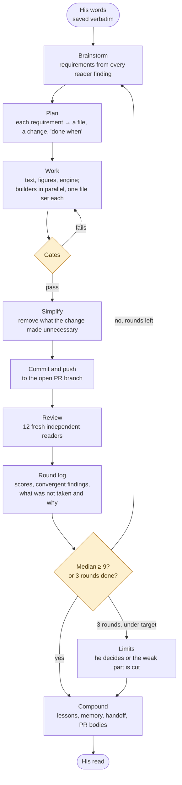

# Playbook: how these articles are made and reviewed

This is the method behind both articles, written down so the next piece starts where this one ended. It joins three things:

- The **compound-engineering loop**: brainstorm, plan, work, simplify, review, compound.
- **Independent readers**: fresh reviewers, each reading as a real person in the audience would.
- **The papers playbook**: gates, a stop rule and a record of every decision.

It was worked out on "Renovate, don't repaint" between 15 and 17 November 2026. Its first real run took the article from a draft its author would not sign to one where twelve independent readers agreed on 7–8 out of 10. That run is recorded in arudaev/dotUni, `docs/papers/innovation/loop-draft-6.md`.

## The loop



## The steps, concretely

| Step | What it means here | Output |
| --- | --- | --- |
| **His words** | Save every message from Alexander verbatim before acting on it. The words decide; summaries drift | `dotUni/.docs/transcripts/YYYY-MM-DD-NNN-slug.txt` |
| **Brainstorm** | Read every reader report. Sort each finding: fact, analogy, argument, reading flow, visual, print, voice, web. Mark who raised it. Two readers, or the specialist for the point, make a finding *convergent*; one reader's taste is noted, not obeyed. A reader's misreading of a number is a legibility fault, not a fact error | A numbered requirements list, each with the readers who raised it |
| **Plan** | Each requirement becomes one change in a named file, with "done when". Decide what is *not* taken and why (his explicit instructions beat any critic) | The plan table in the loop log |
| **Work** | Text edits by hand. Figures by builders in parallel, each owning one file set and checking its own lab shots. Engine changes by hand, checked on both articles | Commits on the PR branch |
| **Gates** | Must pass before any reader sees the piece (below). A failed gate is fixed, never scored | Clean tool output |
| **Simplify** | Reread the diff: duplicated helpers move to `lib/`, unused imports go, padding sentences go | A smaller diff |
| **Review** | Twelve new readers per round (Opus, medium effort), blind to earlier rounds and to our opinion. Each writes its full report to a file and replies with scores only | `readers/rN-<persona>.md` |
| **Round log** | Scores table, convergent findings, the changes they led to, and what was not taken | `loop-draft-6.md` (or the next piece's log) |
| **Compound** | What the round taught, as rules: lessons log, memory, the handoff, the PR bodies | `lessons.md`, memory, `HANDOFF.md` |

## The readers

The panel is the audience the piece will really meet, plus three auditors. Name people by role only.

| Reader | Reads | Asks |
| --- | --- | --- |
| Curious non-specialist | phone, then paper | Does the idea get through to someone who pictures Jarvis? |
| LinkedIn professional | phone | Would I stop scrolling, finish, share, connect? |
| Student AI community member | laptop, then paper | Accurate, worth featuring, can others build on it? |
| Engineering lead, hiring | laptop, then paper | What does this say about the author as a colleague? |
| First boss, academic mentor | paper, then laptop | Rigour, judgement, growth |
| A civil engineer (the analogy's source) | paper, then laptop | Is the building right? A trade reviewer for every technical analogy |
| The course professor | paper, then laptop | The assignment, theory, remedies, pass or fail, questions for the talk |
| Head of IT, German Mittelstand | laptop, then paper | Practical truth; what is missing in operations |
| ML engineer | laptop, then paper | Technical accuracy for the field |
| Visual editor | laptop, phone, paper | Does each figure carry its point? Five-second read against the caption |
| **Fact checker** (web access) | paper and sources | Every number; order and cause words (*before*, *while*, *because*); what a percentage actually measures |
| **Voice and slop critic** | paper plus a tone sample | Does a person come through? Machine patterns, quoted, with rewrites |

For the web version, add device and craft auditors: a **web QA** reader who goes through every device and orientation, and a **performance and accessibility** auditor working from measured traces (see the web gates).

**Rubric.** Each reader scores four things from 1 to 10: visuals, argument, reading and overall. Each also names the three lines or figures that cost the most points, with a one-sentence fix. A score of 9 means "I'd recommend it without reservation"; 7 means "good, with clear flaws".

**Brief, every time.** Each brief gives the persona, the material and the reading order. It asks for the experience, not edits: first impression, reactions as they happen, each figure read before and after its caption, the idea in two sentences, feelings, the impression of the author, and how the devices differ. It names the output file. It never includes earlier scores, our opinion, or another reader's report.

## Gates

Checked before every round, with the tools in `tools/`:

- **Facts.** Every claim has a source in `sources.json` that was opened. The build fails on an unknown id.
- **Render.**
  - `node tools/read.mjs <slug>` reports no problems: passages and the pinned figure stay in step, with no empty stretches.
  - `node tools/shots.mjs <slug> --matrix` is clean at 17 sizes: no overflow, no text below the size floor.
  - The lab audit (`.shots/lab/shoot.mjs`) is clean for every changed figure, in wide, tall and print.
- **Print.**
  - No page more than a quarter empty except the last.
  - Figures appear in order.
  - Every font is embedded as TrueType (`pdffonts` shows no Type 3).
  - Readers get pages rendered with `pdftocairo`. MiKTeX's `pdftoppm` cuts slits into small dots, and readers took them for broken glyphs.
- **Web.**
  - `node tools/perf.mjs <slug>` reports no long task over 50 ms while scrolling, a layout shift score below 0.05, and frames within budget at phone, tablet and laptop sizes in both orientations.
  - **Motion.** `node tools/motion.mjs <slug>` (1536×864 and 390×844) flags no step: nothing changes with the scroll between triggers, every triggered step plays by itself over 0.5–3.5 s of real time in at least 8 visible frames and ends complete, and a step played back takes at least 0.3 s. Look at one `--frames` contact sheet per article.
  - **Timing.** `node tools/timing.mjs` reads both articles at 1536×864 and 390×844 as a wheel reader (100 px ticks, each after reading what it brings in) and a trackpad reader (continuous), both at 230 words a minute, in real time. It flags any step under 0.5 s, over 3.5 s, or complete only after its passage is half read; none may be flagged. Watch one `--video` per article before readers start.
  - Social cards render, and the metadata validates.
  - **Scroll telling.** Every figure that explains something in stages is a `:::scene`, with one passage per step; a static `:::figure` is chosen on purpose, with a reason in the round log. Compare the scene count with the last version he approved on the web. A paper rewrite must not quietly turn scenes into pictures.
  - **Desktop read.** Someone reads the whole page at 1536×864 and 1920×1080 (the common Windows laptop and monitor) before readers start. Each pinned figure fits the screen, and its lettering is readable.
- **Text.** No em dashes (en dashes only), no invisible characters, and dotUni's text gate passes for the records.

## Stop rule

The aim is every reader at 8 or more and a median near 9. Seven is acceptable when the objection is a matter of taste. The playbook allows **three fix rounds**. If a weakness survives two rounds, the plan for that part is wrong, not the draft: redesign it rather than patching it. After three rounds under target, the part goes to **Limits**: he decides, or it is cut. Its code stays in the repo.

## What the first run taught

- **The median is the honest number.** Twelve fresh readers give a stable median, ±1 per reader between rounds. Fixes move the convergent complaints; the median moves only when the case or the structure changes.
- **The fact checker earns its place every round.** It found errors in the thesis sentence itself in all three rounds that no other panel caught: the order of T-Mobile's rewiring, which programme the severance belonged to, contacts against calls, and recommendations shown against recommendations used.
- **A technical analogy needs a trade reviewer.** Lay readers never see the errors: a cable route against DIN 18015-3, a lethal double plug, a building permit rule. The one expert who does see them stops trusting the rest.
- **An analogy for one point stays a sentence.** Where the real facts can be drawn (the law: checks after launch against before), draw the facts.
- **Cut what fails three times.** The renovation-order figure failed as icons, as a Gantt chart and as a ladder. The numbered list with measures did the job.
- **Readers write their own files.** Twelve reports per round fit into one working session only if each reader saves its report and returns only the scores.

- **Render the reading material in one step, right before readers start.** In the second web round the paper pages predated that round's text fixes, and the fact checker checked stale wording. Device sheets, paper pages and the built site come from the same build. It happened again in the scroll-telling round: `shots --matrix` doesn't render print, so the PDF was older than the text. Since then the material for a round comes only from `tools/round.mjs`, which fails if print.pdf wasn't rendered in that run, and it writes a manifest with the commit.
- **A layout rule touches every block type.** Centring the text column when there's no margin rail made the column jump sideways between body, scenes and stills. Check left edges of every text block on every device after any layout change.
- **The paper and the web page are two versions.** The draft-5 restart was written for the paper and turned every scene but one into a static picture. Three web rounds then polished that page, and every gate passed, because no gate asked whether the page still told its story by scrolling. He saw it in one desktop read. A figure may have a print version and a web version, and a passage may be marked for the screen only (`@step n screen`).
- **Still screenshots can't show motion.** After the web rounds of 17 November every step of every scene was drawn in 30 to 60 px of scroll, a flick of the wheel, and figures in the text arrived complete before they came into view. The readers worked from screenshots and filmstrips and never caught it; he did, in one read: "just bang, bang, bang", "a slideshow". Motion is measured now (`tools/motion.mjs`, `tools/timing.mjs`) and looked at in frame sequences and videos.
- **A step must be triggered by the scroll and played by time.** A scroll-scrubbed step has no duration of its own: it lasts as long as the reader's scrolling. Drawn over 30–60 px it was one wheel tick, "bang, bang"; stretched to 320–400 px it lasted 10–30 s at reading pace and changed the figure while the passage before was still being read, a "jump scare" with a mouse wheel. Measure motion in seconds for real readers (a wheel, a trackpad), not in pixels of scroll.
- **A web fix creates the next complaint.** Readers judge the experience as it is, so each fix needs a fresh look on all six devices, not only the one where the complaint came from.

## Tools

```
node lib/build.mjs                         # build dist/
node tools/sources.mjs <slug>              # rebuild sources.json after adding a source
node tools/read.mjs <slug>                 # scene timing and passage checks
node tools/shots.mjs <slug> [--quick|--matrix]   # screenshots, device matrix, print PDF
node tools/filmstrip.mjs <slug> <w> <h> <per>    # read-through sheets for readers
node tools/devices.mjs <slug>              # read-through sheets for every device and orientation
node tools/perf.mjs <slug>                 # scroll trace: long tasks, layout shift, frames
node tools/motion.mjs <slug> [--frames <scene>[:<step>]]   # each step triggered by scroll, played by time; frame sequence of one step
node tools/timing.mjs [slug] [WxH] [--wheel|--trackpad]     # real-time durations for a wheel and a trackpad reader at reading pace
node tools/timing.mjs --video [slug]       # reading-pace videos into .shots/video/
node tools/round.mjs <slug> <outDir>       # ALL reading material for a round from one build, with a manifest
node tools/cards.mjs                       # social preview images
node .shots/lab/shoot.mjs name="fig=<id>&layout=wide&step=2&t=1"   # one figure state
pdftocairo -r 110 -png .shots/<slug>/print.pdf <out>/page          # paper pages for readers
```
